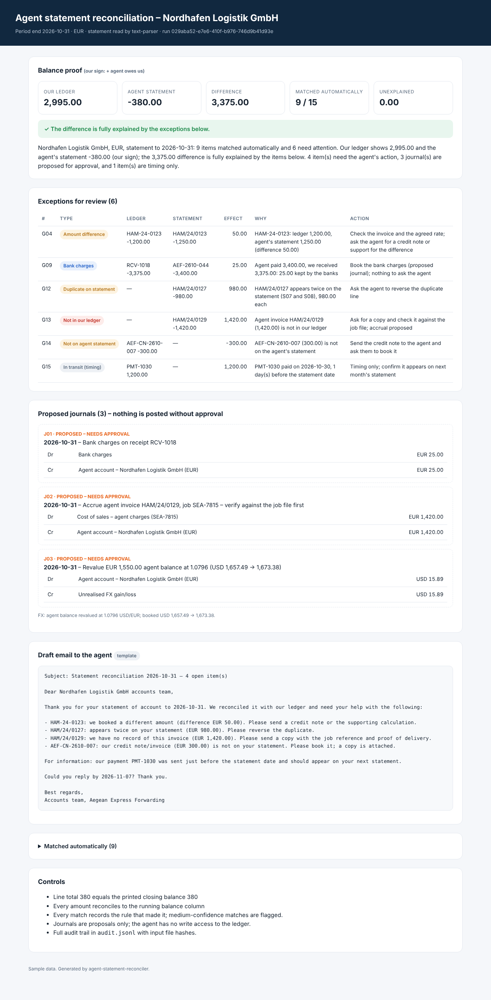
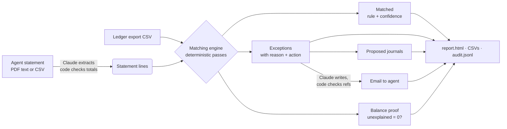

# agent-statement-reconciler

[](https://www.agensi.io/skills/agent-statement-reconciler)

An AI agent that reconciles overseas agent and intercompany statements against the ledger. The agent matches everything that ties and explains the rest. It proposes the journals and drafts the email to the agent. **A person approves anything that is posted or sent.**

I spent 9 years reconciling overseas agent accounts by hand at an international freight forwarder. This is the tool I wanted then.



## What it does

Run it on the sample (a Hamburg agent's October statement against our ledger) and in under a second it gives you this:

| Result | |
|---|---|
| Ledger balance | 2,995.00 (agent owes us) |
| Agent statement | −380.00 (we owe the agent) |
| Difference | 3,375.00 |
| **Unexplained** | **0.00**: every euro of the difference is accounted for by an exception |
| Matched automatically | 9 of 15 groups, each tagged with the rule that matched it |

| Exception | Effect | What happens |
|---|---:|---|
| Amount difference (HAM/24/0123: 1,200 booked vs 1,250 billed) | 50.00 | Asked of the agent in the email |
| Bank charges (agent paid 3,400, we received 3,375) | 25.00 | Journal proposed, internal only |
| Duplicate on the statement (HAM/24/0127 twice) | 980.00 | Agent asked to reverse it |
| Agent invoice not in our ledger (HAM/24/0129) | 1,420.00 | Accrual proposed against job SEA-7815 |
| Our credit note not on their statement | −300.00 | Agent asked to book it |
| Payment in transit (paid 30 Oct, statement 31 Oct) | 1,200.00 | Timing only, no action |

It also revalues the EUR agent balance at the period-end rate and proposes the unrealised FX journal.

## How it works



**Deterministic where it must be right, AI where it helps.**

- **Claude reads messy statements.** It extracts the lines from printed or PDF statements in any layout, using a tool call with a strict schema. The code then checks that the extracted lines add up to the printed closing balance. If they don't, the AI output is rejected and a deterministic parser takes over. That parser works out debit or credit from the running-balance column, so it does not trust the column positions.
- **Matching is code, not AI.** It runs in seven passes, and each match records the rule that made it:
  1. Opening balances.
  2. Documents by reference. References are normalised, so `HAM/24/0121` = `HAM-24-121` and `AEF2610051` = `AEF-2610-051`.
  3. Payments by the documents they settle, including one payment against several statement lines and short receipts as bank charges.
  4. Payments with no reference, by amount and date window. These are flagged as medium confidence.
  5. Duplicates on the statement.
  6. Lines only on the statement.
  7. Lines only in the ledger, with in-transit detection near the period end.
- **Balance proof.** Ledger − statement must equal the sum of the exception effects. The run fails, with exit code 1, if anything is unexplained.
- **Claude writes the human parts.** That means the reviewer summary and the email to the agent. The code checks that the email names every item the agent must act on. If no API key is set, templates are used.
- **MCP server.** Claude Desktop, Claude Code or any MCP client can run the reconciliation as a tool, ask why a line was matched, and fetch the email draft.
- **Audit trail.** `audit.jsonl` holds input file hashes, every match decision with its rule, the balance proof, every proposed journal, and every AI call with the model and prompt hash.
- **Scheduled.** A GitHub Actions workflow runs the tests on every push and the reconciliation every weekday morning, and uploads the report as an artifact.

## Run it

Requires Node 20+. These commands work in PowerShell, bash and zsh.

```bash
npm install
npm run demo        # printed statement (text) → out/report.html
npm run demo:csv    # same statement as CSV, same result
npm test            # 7 tests: normalisation, parser controls, the full sample, CSV = text, email coverage, MCP
```

Optional: set `ANTHROPIC_API_KEY` to have Claude read the statement and write the narrative. `ANTHROPIC_MODEL` overrides the model.

Your own files:

```bash
npm run reconcile -- --ledger my-ledger.csv --statement agent-statement.txt --fx fx-rates.csv --out out
```

Ledger columns: `date, doc_no, doc_type (OB|INV|CN|AGINV|AGCN|PAYIN|PAYOUT), job_no, applies_to, description, currency, amount, usd_rate, amount_usd`. Amounts are signed from our side: positive means the agent owes us.

## Use it from Claude (MCP)

`.mcp.json` registers the server for Claude Code in this folder. For Claude Desktop, add this to `claude_desktop_config.json`:

```json
{ "mcpServers": { "agent-statement-reconciler": { "command": "npx", "args": ["tsx", "C:/path/to/agent-statement-reconciler/src/mcp-server.ts"] } } }
```

Then ask: *"Reconcile the Hamburg statement for October, explain S08, and give me the email for the agent."*

| Tool | Does |
|---|---|
| `reconcile_statement` | Runs the reconciliation; returns the balance proof, exceptions, proposed journals and file paths |
| `explain_item` | Shows how a ledger line, statement line or group was matched, by which rule, and its effect |
| `draft_agent_email` | Returns the draft email listing only what the agent must act on |

There is deliberately no tool that posts to a ledger.

## Use it as an agent skill

[`skills/agent-statement-reconciler`](skills/agent-statement-reconciler) packages the reconciler as a `SKILL.md` skill for Claude Code, Cursor, Codex CLI and other agents that read the format. It tells the agent when to use the reconciler, how to prepare and check the inputs (`scripts/check-inputs.mjs`), how to read the balance proof and the exceptions, and what it must never do: post to a ledger or send the email.

To install it, copy the folder into your agent's skills directory, for example `~/.claude/skills/` for Claude Code, or install it from [Agensi](https://www.agensi.io/skills/agent-statement-reconciler).

## Controls

- The agent has read-only access. Journals are proposals with the status `proposed – needs approval`.
- AI output is never trusted on its own. Extraction must tie to the printed closing balance, and the email must contain every reference that needs action.
- Medium-confidence matches (amount and date only) are labelled in the report.
- Every run is reproducible from the hashed inputs in the audit log.

## Layout

```
src/normalize.ts   reference keys, amounts, dates
src/parse.ts       ledger CSV, statement CSV, printed-statement parser with balance checks
src/engine.ts      matching passes, balance proof, proposed journals, FX revaluation
src/llm.ts         Claude: statement extraction (validated), summary and email (checked)
src/report.ts      HTML, Markdown and CSV outputs
src/audit.ts       append-only JSONL audit trail
src/run.ts         one run end to end
src/cli.ts         command line
src/mcp-server.ts  MCP tools
data/sample/       fictional agent statement, ledger and FX rates
```

## Next

- Bank statement reconciliation (camt.053 / MT940) on the same engine.
- Intercompany pairs: reconcile both sides of a group company in one run.
- Connectors that read the ledger straight from an ERP's API instead of a CSV export.

All companies, references and amounts in `data/sample` are fictional.
